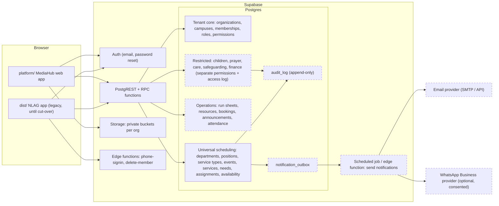

# MediaHub → Church Operations Platform: Audit, Architecture and Phased Plan

Prepared 2026-10-20 from the actual repository in `MEDIAHUB/`. Phase 1 has been implemented and tested (see §10). All later phases are proposals for review.

Contents

1. [Audit of the existing project](#1-audit-of-the-existing-project)
2. [Working, incomplete and missing features](#2-working-incomplete-and-missing-features)
3. [Architecture diagram](#3-architecture-diagram)
4. [Proposed multi-tenant database design](#4-proposed-multi-tenant-database-design)
5. [Security and privacy assessment](#5-security-and-privacy-assessment)
6. [Phased implementation plan](#6-phased-implementation-plan)
7. [Files and database objects per phase](#7-files-and-database-objects-per-phase)
8. [Testing and migration plan](#8-testing-and-migration-plan)
9. [Risks and unresolved decisions](#9-risks-and-unresolved-decisions)
10. [Phase 1 report](#10-phase-1-report)
11. [UI/UX audit and design plan](#11-uiux-audit-and-design-plan)

---

## 1. Audit of the existing project

### 1.1 Repository layout

| Path | What it is |
|---|---|
| `dist/` | The live **NLAG Service Team** app (nlagmediahub.xyz). Static site, no build step. |
| `dist/app.js` (68 KB, 110 very long lines) | Entire UI: login, recovery, availability, schedule, published roster, my duties, profile, team admin, WhatsApp text, permanent delete. HTML is built with template strings and `innerHTML`. |
| `dist/api.js`, `dist/core.js` | Supabase calls; pure scheduling rules (eligibility, validation, augmenting-path Auto Assign). |
| `dist/service-transitions.js` | Mobile-only, direction-aware swipe between services with reduced-motion support. |
| `dist/*.css` (6 files, ~73 KB) | `styles.css` (base, teal palette) overridden by `theme.css` (NLAG navy/blue/lime), plus `responsive.css`, `welcome.css`, `mobile-welcome.css`, `mobile-profile.css`. |
| `dist/vendor/supabase.js` | Vendored `@supabase/supabase-js` 2.117.2 built by `build-vendor.mjs`. |
| `dist/config.js` | Public Supabase URL and publishable key (no secrets). |
| `dist/_headers` | CSP, HSTS, frame, referrer and permissions headers. |
| `platform/` | The new multi-organization app added on 2026-10-20 (same stack). |
| `supabase/*.sql` | Hand-applied migrations (see §1.4). |
| `supabase/functions/` | Two Deno edge functions: `phone-signin`, `delete-team-member`. |
| `tests/` | `node:test` + PGlite (PostgreSQL in WebAssembly) tests. |

There is **no git repository**, no CI, no linter and no type checking. `npm test` and `node check.mjs` are the only checks.

### 1.2 Technology stack and patterns

- **Frontend:** vanilla ES modules, no framework, no bundler. Whole-screen re-render on every state change (`app.innerHTML = …`), event delegation via `data-action` attributes.
- **Backend:** Supabase only. PostgreSQL with RLS, Supabase Auth (email + password, plus phone-as-username through an edge function), private Storage bucket `avatars`.
- **Write pattern:** the NLAG app never writes tables directly. Every mutation is a `security definer` RPC that re-checks authorization, validates input, serializes with a global advisory lock (`823714`) and uses revision numbers to reject stale saves. This is a good pattern and the platform keeps it for anything multi-step.
- **Hosting:** static files (headers file suggests Cloudflare Pages or Netlify).

### 1.3 Existing features mapped to code

| Feature | UI (`dist/app.js`) | Database |
|---|---|---|
| Register / sign in (email) | `login`, `authenticate` | Supabase Auth; `handle_new_member` trigger creates `profiles` |
| Sign in with phone | `signInWithIdentifier` | `phone-signin` edge fn → `resolve_phone_signin` (rate limited) |
| Password reset | `passwordRecoveryPage`, `requestPasswordReset` | Supabase Auth |
| Profile (name, phone, photo) | `profile`, `saveProfile` | `save_profile`, `avatars` bucket |
| Availability per date and campus | `mine`, `submitAvailability` | `submit_campus_availability`, `availability` |
| Admin availability board, filters, 15 s refresh | `availability`, `refresh` | `availability`, `profiles` |
| Schedule a service (Producer, CCU, 0–16 cameras, "Not needed") | `schedule`, `saveSchedule`, `pick` | `save_schedule` (6-arg), `schedules`, `assignments` |
| Auto Assign (maximum matching, keeps manual picks) | `core.autoAssign` | client-side only |
| Publish / draft, stale-save protection | `saveSchedule` | `status`, `revision` |
| Published roster for members | `publishedSchedule` | `published_schedule()` |
| Team admin: skills, active flag | `team`, `editMember` | `manage_member` |
| Permanent member removal | `removePermanently` | `delete-team-member` edge fn → `permanently_delete_member` |
| WhatsApp roster text (copy only) | `whatsapp` | none |
| Mobile swipe between services | `service-transitions.js` | none |
| Sample workspace when unconfigured | `sampleData` | none |

### 1.4 Database objects and migration order

Tables: `profiles`, `services` (6 rows: 4 Kompally, 2 Eden Square), `availability`, `schedules`, `assignments`; private `service_team_private.phone_signin_limits`.
Platform (added): `organizations`, `org_members`, `teams`, `positions`, `member_positions`, `events`, `event_services`, `event_needs`, `plan_items`, `plan_assignments`, `blockouts`, `platform_private.join_attempts`.

Migrations have no numbering after `003` and no tracking table. The order that actually works (now asserted by `tests/phase1.test.mjs`):

```
001_schema.sql → 002_storage.sql → camera-count.sql → 003_harden_performance.sql →
camera-not-needed.sql → campuses.sql → permanent-delete.sql → phone-signin.sql →
004_platform.sql → 005_phase1_stabilize.sql
```

`SETUP.sql` is a copy of `001` + `002` only, so it silently produces an outdated schema if someone uses it on a fresh project.

### 1.5 Hardcoded values

- Services and campuses: `dist/core.js` (`services`, `campuses`, `servicesFor`) and SQL check constraints (`campus_id in ('kompally','eden_square')`).
- Skills: `camera`, `producer`, `ccu` in SQL checks and RPCs.
- Positions: `producer`, `ccu`, `cam_1…cam_16` in SQL.
- Branding: "NLAG", "Video team", "For His glory" in `app.js`; logo and banner PNGs (1.5–1.6 MB each, unoptimized).
- Origins: edge functions allow `https://nlagmediahub.xyz` and `https://service-team-roster.riyazshaik2510.chatgpt.site`.
- Email redirect: `https://nlagmediahub.xyz/` in `app.js`.
- Phone normalization assumes India (+91).
- Global advisory lock id `823714` shared by every scheduling mutation.

### 1.6 Duplicate code and maintainability

- Two scheduling engines now exist (`dist/core.js` for fixed positions, `platform/core.js` for configurable positions). Phase 3 retires the first.
- Six overlapping stylesheets in `dist/`; `styles.css` defines a palette that `theme.css` overrides.
- `save_schedule` is redefined in three migrations; `submit_availability` in two.
- `app.js` is one file of 110 lines averaging ~620 characters each, which makes review and safe change hard.

---

## 2. Working, incomplete and missing features

Status legend: **Working** = verified by code reading plus an automated test or browser run. **Partial** = some of the requirement exists. **UI only** = a screen without real backing. **Missing** = nothing exists.

### NLAG Service Team app (`dist/`)

| Area | Status | Evidence / gap |
|---|---|---|
| Email sign-up, sign-in, reset | Working | Supabase Auth; recovery edge cases handled in `start()` |
| Phone sign-in | Working | `tests/phone-signin.test.mjs`; India-only normalization |
| Availability per date and campus | Working | `tests/campuses.test.mjs` |
| Scheduling, camera count, Not needed, publish, stale-save check | Working | `tests/database.test.mjs`, `camera-not-needed.test.mjs` |
| Auto Assign | Working | `tests/core.test.mjs` (matching, preserved picks) |
| Member management and permanent delete | Working | `tests/permanent-delete.test.mjs`; edge function untested |
| Profile photos | Partial | Storage policies untestable in PGlite; size/type checked client-side and by bucket limits |
| Mobile swipe transitions | Working | Responsive QA notes (Sept 30); not re-run in this phase |
| WhatsApp | Partial | Copyable text only; nothing is sent |
| Notifications / reminders | Missing | |
| Multiple churches | Missing | Single global team, global admin flag |
| Audit log | Missing | Only `schedules.updated_by` |

### MediaHub platform (`platform/`)

| Area | Status | Evidence / gap |
|---|---|---|
| Sign-up, sign-in, reset | Working in code, not run against live Supabase | Same Supabase Auth calls; browser-tested in sample mode only |
| Organizations, owner/admin/member, invite code, switching | Working | `tests/platform.test.mjs`, `tests/phase1.test.mjs` |
| Teams and positions (departments-lite) | Working | browser run |
| Events with N services and per-position headcount | Working | browser run, DB test |
| Scheduling, Auto-fill, accept/decline | Working | `tests/platform-core.test.mjs`, DB test |
| Service plan / run sheet | Working | browser run |
| Blockout dates | Working | DB test |
| Publish / duplicate | Working | DB test |
| Campuses, service types, recurring schedules | Missing | |
| Configurable roles and permissions | Missing | three fixed roles |
| Notifications (email/in-app center) | Missing | the Home page lists requests; nothing is emailed |
| Calendar views, resources, announcements, reports | Missing | |
| Sensitive modules (children, prayer, care, finance, safety) | Missing | intentionally not started; need the permission model first |
| Platform administration, billing | Missing | |

Everything in the master prompt sections 4 (departments A–O), 6–14 beyond what is listed above is **Missing**.

---

## 3. Architecture diagram

Target architecture (Phase 2 onward). Solid boxes exist today; dashed boxes are proposed.



Principles:

1. **One tenant key.** Every organization-owned row carries `org_id`; child tables use composite foreign keys `(org_id, parent_id)` so a row can never reference another tenant's parent (already used by `004_platform.sql`).
2. **Authorization in the database.** RLS for reads and simple writes; `security definer` RPCs for multi-row or cross-table changes. The client never supplies a trusted role or permission.
3. **Permissions, not role names.** Policies call `has_permission(org, 'schedule.manage', department?)`. Roles are editable bundles of permissions per organization.
4. **Restricted data is physically separate** (own tables, own permissions, access logging), never a column on a general table.
5. **Side effects through an outbox.** RPCs insert notification rows with an idempotency key; a job delivers them, records failures and retries.

---

## 4. Proposed multi-tenant database design

Reuse first. "→" means an existing table gains columns; "new" means a new table.

| Conceptual entity | Table | Notes |
|---|---|---|
| organizations | `organizations` → add `slug unique`, `time_zone`, `locale`, `week_start`, `logo_path`, `contact jsonb`, `status ('active','suspended','closed')`, `features jsonb`, `plan` | `status <> 'active'` blocks writes through `is_org_member()` |
| campuses | new `campuses(org_id, id, name, address, time_zone, archived_at)` | NLAG Kompally + Eden Square migrate here |
| memberships | `org_members` → add `status ('invited','active','deactivated')`, `role_id`, `invited_by`, `deactivated_at` | replaces the fixed `role` text after migration |
| invitations | new `invitations(org_id, email, role_id, token_hash, expires_at, accepted_at)` | email invites in addition to codes; unique per (org, email) to stop duplicates |
| role_definitions | new `roles(org_id null = template, id, key, name, is_system)` | templates: Owner, Church admin, Campus admin, Department leader, Scheduler, Finance manager, Facilities manager, Safeguarding officer, Staff, Volunteer, Member |
| role_permissions | new `role_permissions(role_id, permission, scope ('org','campus','department'))` | permission keys listed in §5.4 |
| departments | `teams` → add `description`, `leader_id`, `campus_id`, `template_key`, `archived_at` (UI name: Departments) | no data copy needed |
| department_memberships | new `department_members(org_id, department_id, user_id, dept_role ('leader','coordinator','member'))` | department role ≠ platform permissions |
| skills / role eligibility | `positions`, `member_positions` (exist) → add `training_expires_on` | |
| service_templates / types | new `service_types(org_id, id, campus_id, department scope, name, default_start, default_needs jsonb, recurrence rrule)` | generates events |
| events / services | `events` → add `campus_id`, `service_type_id`, `kind ('service','rehearsal','meeting','event','class','outreach')`, `status` adds `'cancelled','completed'`, `starts_at timestamptz`; `event_services` → add `starts_at timestamptz`, `location_id` | timestamps stored in UTC, rendered in org time zone |
| schedules / assignments | `event_needs`, `plan_assignments` (exist) → add `assigned_by`, `source ('manual','auto')`, `confirmed_at`; new `replacement_requests` | |
| availability | `blockouts` (exist) + new `availability_responses(org_id, service_id, user_id, status)` for the NLAG "submit availability per service" workflow | needed before NLAG cut-over |
| confirmation_records | covered by `plan_assignments.status/responded_at` + `audit_log` | no separate table |
| attendance | new `attendance(org_id, event_service_id, person_id, status, recorded_by)` | |
| people (non-account) | new `people(org_id, id, user_id null, name, …)` | visitors, children, guardians who have no login |
| event_registrations | new `registrations(org_id, event_id, person_id, status ('registered','waitlisted','cancelled','checked_in'))` | capacity enforced in RPC |
| resources | new `resources(org_id, id, campus_id, kind, name, asset_tag unique per org, status)` | one physical item, shared by departments |
| resource_bookings | new `resource_bookings(org_id, resource_id, during tstzrange, event_id, status)` with `exclude using gist (resource_id with =, during with &&) where status='approved'` | conflict detection in the database |
| maintenance_records | new `maintenance(org_id, resource_id, kind, severity, status, assigned_to, notes)` | |
| announcements | new `announcements(org_id, audience jsonb, publish_at, expires_at, requires_ack)`, `announcement_reads` | |
| notifications | new `notifications(org_id, user_id, kind, payload, read_at)` (in-app) and `notification_outbox(idempotency_key unique, channel, status, attempts, last_error)` | |
| audit_logs | new `audit_log(org_id, actor_id, action, entity, entity_id, before jsonb, after jsonb, at)`; insert-only, no update/delete grants | written by RPCs and triggers |
| restricted modules | new `child_records`, `guardian_links`, `pickup_authorizations`, `prayer_requests`, `care_records`, `safety_incidents`, `finance_*` | each behind its own permission; reads logged |
| platform admins | new `platform_admins(user_id)`, `support_access_grants(org_id, granted_by, expires_at, reason)` | platform staff see org metadata only unless a time-limited grant exists |
| subscriptions | later: `subscriptions(org_id, plan, status, provider_ref)`, entitlements checked server-side | Phase 6 |

Indexes: every foreign key column and every `(org_id, …)` lookup; `events(org_id, starts_at)`; `plan_assignments(user_id)` (exists).

---

## 5. Security and privacy assessment

### 5.1 Fixed in Phase 1

| # | Finding | Severity | Fix |
|---|---|---|---|
| S1 | Both apps share `profiles`. Every platform sign-up became an **active NLAG member** (could submit availability and read the NLAG roster), and **NLAG admins could read every platform user's email and phone**. | Critical (cross-tenant) | `profiles.legacy_team` set from sign-up metadata; NLAG helpers, policies, `manage_member` and `permanently_delete_member` now ignore non-NLAG accounts. Test: `phase1.test.mjs`. |
| S2 | Any organization member could read the invite code and invite strangers. | Medium | Column-level grant hides `join_code`; admins use `org_invite_code()`. |
| S3 | Invite codes could be guessed without limit. | Medium | 10 failed attempts per user per hour (`platform_private.join_attempts`). |
| S4 | `organizations.created_by` blocked deleting the creator's account (and therefore member removal). | Medium (lifecycle) | Nullable, `on delete set null`; permanent delete refuses organization owners with a clear message. |

### 5.2 Open findings

| # | Finding | Severity | Recommendation |
|---|---|---|---|
| S5 | NLAG registration is open: anyone who signs up at the NLAG site is an *active* member and can read published roster names. | Medium | Decision D1: default new NLAG accounts to inactive until an admin approves. |
| S6 | `phone-signin` has a global 120/minute bucket; an attacker can exhaust it and block phone sign-in for everyone (email still works). Per-phone bucket allows targeted lockout. | Low–Medium | Rate-limit by client IP at the edge, keep per-phone limit, drop the global bucket or raise it. |
| S7 | Edge functions allow a leftover preview origin (`*.chatgpt.site`). | Low | Remove if unused; move origins to an environment variable. |
| S8 | No audit log for admin actions (skill changes, deactivation, deletes, publishing, role changes). | Medium | `audit_log` in Phase 2. |
| S9 | `delete-team-member` deletes photos before the database row; a database failure leaves a member without a photo. | Low | Delete the row first, then storage, with a retry list. |
| S10 | Platform `createEvent` is three separate inserts with a compensating delete. | Low (integrity) | Single `create_event` RPC in Phase 3. |
| S11 | No version control, no CI, no backups documented, no restore test. | High (operational) | Decision D3; enable Supabase PITR or daily backups and test a restore. |
| S12 | Supabase built-in email is rate-limited and not meant for production invitations/reminders. | Medium | Custom SMTP (Decision D5). |
| S13 | Google Fonts are loaded from Google in both apps (third-party request with visitor IP). | Low (privacy) | Self-host the two fonts. |
| S14 | 1.5–1.6 MB PNGs on first load. | Low (performance) | Compress to WebP/AVIF. |

### 5.3 Data minimization

Collect only name, email, phone (optional in the platform) and photo (NLAG). Emergency contacts, children's data, prayer and care notes must not be added to `profiles`; they get their own restricted tables in Phase 4 with retention settings.

### 5.4 Permission model (Phase 2)

Permission keys, grouped so that operational access never implies sensitive access:

- Operational: `org.manage`, `members.manage`, `members.contact.read`, `departments.manage`, `schedule.manage`, `schedule.publish`, `events.manage`, `resources.manage`, `facilities.approve`, `announcements.publish`, `reports.read`.
- Sensitive (never in a template except the named one): `children.read`, `children.manage` (Safeguarding officer, Children's leader), `prayer.read` (Prayer team), `care.read`, `care.manage` (Pastoral), `safety.read` (Safety officer), `finance.read`, `finance.manage` (Finance manager).
- Rules: owner cannot be removed except by ownership transfer; nobody can grant a permission they lack; sensitive reads are logged; platform admins have no org permissions by default.

### 5.5 Jurisdiction

The church is in India, so the Digital Personal Data Protection Act 2023 is the likely baseline (consent, purpose limitation, children's data needing verifiable guardian consent). This plan does not claim compliance; Decision D6 asks for legal review before children's, care or finance modules go live.

---

## 6. Phased implementation plan

| Phase | Goal | Main work | Exit criteria |
|---|---|---|---|
| **1. Audit and stabilize** (done) | Safe foundation | This document; fixes S1–S4; migration-order test; NLAG behaviour unchanged | 21 tests pass; NLAG flows untouched |
| **2. Shared platform foundation** | Real multi-church core | campuses; org profile, time zone, status; email invitations; roles + permissions + `has_permission`; department fields and memberships; `audit_log`; onboarding wizard (church details → campuses → departments → service types → invite → first schedule, every step skippable); platform admin list of orgs (metadata only) | cross-tenant and privilege-escalation tests for every table; owner transfer works |
| **3. Universal scheduling** | One engine for every department | service types + recurrence; availability responses; replacement requests; cancel/complete states; time-zone-aware times; `create_event` RPC; schedule history; in-app notifications + outbox + email delivery job; reminders; **NLAG data migration** and cut-over | NLAG team runs a month on the platform with parity (cameras, Not needed, campuses, WhatsApp text, swipe); `dist/` retired read-only |
| **4. Department expansion** | Templates and modules | worship (songs with CCLI-safe metadata, setlists, keys), tech (checklists, issues), hospitality, youth; then children's ministry, prayer, care, outreach, events/registrations, facilities, transport, each behind its permission | each module has permission tests and access logging where sensitive |
| **5. Administration and reporting** | Org-wide view | calendar (month/week/day/agenda), resources and bookings with conflict exclusion, attendance, reports from real data, CSV export | numbers trace to records; exports respect permissions |
| **6. SaaS readiness** | Many churches | onboarding polish, entitlements (server-side), monitoring, backups with restore drill, support access grants, pilot with 2–3 churches | pilot churches onboard without help |
| **7. Advanced** | Only where useful | AI schedule suggestions (human approves), announcement drafts, integrations | |

The UI redesign (§11) runs alongside Phases 2–3, starting with the shell, dashboard and scheduling.

---

## 7. Files and database objects per phase

**Phase 1 (done)**
- New: `supabase/005_phase1_stabilize.sql`, `tests/phase1.test.mjs`, `docs/PLATFORM-AUDIT-AND-PLAN.md`
- Changed: `platform/store.js` (sign-up tag, invite code RPC, hidden codes), `platform/app.js` (invite panel), `tests/platform.test.mjs`, `README.md`
- DB: `profiles.legacy_team`; replaced `handle_new_member`, `is_team_admin`, `is_active_member`, `profile_read` policy, `manage_member`, `permanently_delete_member`, `join_organization`; new `org_invite_code`, `platform_private.join_attempts`; altered `organizations.created_by`, column grants on `organizations`

**Phase 2**
- New migration `006_tenant_core.sql`: `campuses`, `roles`, `role_permissions`, `department_members`, `invitations`, `audit_log`, `has_permission()`, org columns, `org_members.status/role_id`, rewritten policies on all platform tables.
- New edge function `send-invitation` (or Supabase `inviteUserByEmail` through a function).
- `platform/`: split `app.js` into `ui/` components and `pages/` (see §11), `onboarding.js`, `settings.js`, `departments.js`.
- Tests: `tenant-isolation.test.mjs` (table-by-table cross-org matrix), `permissions.test.mjs`.

**Phase 3**
- `007_scheduling.sql`: `service_types`, `availability_responses`, `replacement_requests`, `notifications`, `notification_outbox`, event/service time columns, `create_event`, `save_service_assignments` with audit.
- `008_nlag_migration.sql` + `scripts/migrate-nlag.mjs` (idempotent, with a mapping table and verification counts).
- Edge function `deliver-notifications` on a schedule.
- `platform/pages/schedule.js` (with the swipe module ported from `dist/service-transitions.js`), `calendar.js`.

**Phases 4–6**: one migration and one `pages/<module>.js` per module; `platform-admin/` area; `subscriptions` objects only when billing is approved.

---

## 8. Testing and migration plan

### Automated tests (run with `npm test`)

| Suite | Covers |
|---|---|
| `core.test.mjs`, `database.test.mjs`, `camera-not-needed`, `campuses`, `permanent-delete`, `phone-signin` | existing NLAG behaviour (unchanged, still passing) |
| `platform-core.test.mjs` | slot building, Auto-fill matching and fairness, warnings, plan times |
| `platform.test.mjs` | org isolation, roles, invites, rosters, accept/decline, need trimming, duplication, blockouts, leaving, deletion |
| `phase1.test.mjs` | full migration chain in order; platform sign-ups excluded from NLAG; invite codes admin-only; guessing throttled; creator deletion |

From Phase 2, every new table must ship with (a) a cross-org read/write test, (b) a lowest-role write test, (c) a sensitive-read logging test where relevant. Browser checks run with Playwright against `?demo` at 390 px and 1360 px.

Not yet automated: Storage policies, edge functions, real email delivery, concurrent sessions (PGlite is single-session). These need a Supabase staging project (Decision D4).

### Applying migrations to the live project

1. Take a backup (Dashboard → Database → Backups, or `pg_dump`).
2. Apply in a staging copy first and run the NLAG smoke test: sign in as admin, open a service, save a draft, publish, sign in as a member and submit availability.
3. Apply `004_platform.sql`, then `005_phase1_stabilize.sql`, then `006_tenant_core.sql`, then `007_scheduling.sql`, `008_availability.sql` and `009_nlag_import.sql`, in the SQL editor of production.
4. Verify: `select count(*) from profiles where not legacy_team` is 0 right after applying (all existing accounts keep access).
5. Rollback for 005 if needed: it only adds objects and replaces functions. Re-running the earlier definitions (`handle_new_member` and `manage_member` from `001_schema.sql`, the helpers and `profile_read` from `003_harden_performance.sql`, `permanently_delete_member` from `permanent-delete.sql`, `join_organization` from `004_platform.sql`) restores the previous behaviour; the new column and table can stay.

### NLAG data migration (Phase 3)

Map: NLAG → organization "New Life Assembly of God" (name to confirm); Kompally, Eden Square → campuses; Video → department; Producer, CCU, Camera → positions; `profiles.skills` → `member_positions`; `is_admin` → admin role; each `(service_date, service_id)` schedule → event + event_service with Camera quantity = `camera_count` minus "Not needed"; assignments → `plan_assignments` (status `accepted` for published history). The script writes a mapping table, is safe to re-run, and finishes with count comparisons per date. `dist/` stays live until a month of parallel running passes.

---

## 9. Risks and unresolved decisions

### Decisions needed from you

| # | Decision | Options | Recommendation |
|---|---|---|---|
| D1 | NLAG open registration | keep as is / new accounts inactive until approved | **Approve first**: stops strangers reading the roster |
| D2 | One app or two | keep `dist/` forever / migrate NLAG into the platform | **Migrate in Phase 3**, keep `dist/` until parity is proven |
| D3 | Version control | none / private GitHub repo | **Private GitHub repo now**: enables review, rollback and CI |
| D4 | Staging environment | test on production / second Supabase project | **Staging project** for migrations and email tests |
| D5 | Email delivery | Supabase default / custom SMTP (e.g. Resend, Postmark, SES) | **Custom SMTP** before invitations and reminders |
| D6 | Children, care, prayer, finance modules | build now / after legal review | **After review** of DPDP and child-protection duties |
| D7 | Frontend structure at 15+ modules | stay no-build / add Vite + TypeScript, still vanilla components | **Add Vite + TypeScript in Phase 2**; no framework change, but type checks and modules |
| D8 | Domain | platform at `app.nlagmediahub.xyz` / a neutral product domain | product domain if other churches will sign up |
| D9 | Song lyrics | store lyrics / store titles, keys and CCLI numbers only | **Metadata only** unless the church holds the right licence |
| D10 | WhatsApp | keep copy-text / WhatsApp Business API provider with opt-in | copy-text until there is budget and consent flow |

### Risks

- **Scope**: the master prompt describes many products. Mitigation: phases with exit criteria; sensitive modules last.
- **Single maintainer, no VCS**: one bad edit can break the live NLAG app. Mitigation: D3, D4.
- **Shared Supabase project**: NLAG and the platform share auth and `profiles`; every policy change must be tested against both (the Phase 1 chain test does this).
- **Children's data**: legal and reputational harm if mishandled. Mitigation: D6, separate tables, access logs, no exposure in schedules.
- **Unverified live behaviour**: the platform has not been run against the live Supabase project yet; first live run should be on staging.

---

## 10. Phase 1 report

**What changed**
- `supabase/005_phase1_stabilize.sql` (new): fixes S1–S4 above.
- `platform/store.js`: sign-ups are tagged `app: mediahub-platform`; organizations are read without invite codes; the invite code comes from `org_invite_code()`; an invalid code returns a clear message.
- `platform/app.js`: invite panel uses the admin-only code.
- `tests/phase1.test.mjs` (new): migration chain, NLAG isolation, invite code rules, creator deletion. `tests/platform.test.mjs` updated for hidden codes.
- `README.md`: migration order and Phase 1 steps. This document.

**Verified**
- `npm test`: 21 of 21 pass (13 pre-existing NLAG tests unchanged).
- `node check.mjs`: syntax and assets for both apps.
- Browser (Playwright, sample mode, 1360 px and 390 px): full walkthrough, invite code shown to admins, invalid code message, no horizontal overflow, no console errors other than blocked web fonts in the test sandbox.

**Manual configuration still required**
1. Run `004_platform.sql` then `005_phase1_stabilize.sql` in Supabase (after a backup).
2. Add the platform's address to Supabase Auth redirect URLs; deploy `platform/`.
3. Decide D1–D10.

**Not done in Phase 1**: no NLAG UI or behaviour changes; S5–S14 remain open; nothing has been run against the live database from here.

---

## 11. UI/UX audit and design plan

### 11.1 Current UI audit

NLAG app (`dist/`)
- Strengths: coherent NLAG palette, polished mobile schedule with swipe, accessible dialogs and table scrolling (Sept 30 QA).
- Problems: six stylesheets overriding one another; whole-app `innerHTML` re-render loses focus and scroll on refresh; very large images; NLAG-specific copy baked into components; navigation is team-specific and cannot scale to more modules.

Platform (`platform/`)
- Strengths: single stylesheet, clear event → services → people/plan hierarchy, mobile layout without overflow, real data only.
- Problems: no design tokens beyond colours; no dark theme; no notification center, search or breadcrumbs; "Loading…" text instead of skeletons; sidebar lists every page (will not scale); dialogs for most edits; full re-render on each change.

### 11.2 Design system

- **Colour tokens**: `--navy #061a49`, `--ink #08265f`, `--blue #064ac5` (primary), `--lime #95f500` (brand accent, used sparingly for active nav and confirmed states), neutrals `--surface #fff`, `--bg #f5f7fb`, `--line #dbe4f2`, `--muted #566782`; status `--success #2f6b00`, `--warning #8a5a00`, `--danger #9b3528`, `--info #064ac5`. Dark theme mirrors each token.
- **Type**: Manrope for headings (600–800), DM Sans for UI text; scale 12 / 14 / 16 / 18 / 22 / 28 px.
- **Spacing**: 4 px base (4, 8, 12, 16, 24, 32, 48). **Radii**: 8 (controls), 12 (cards), 999 (pills). **Shadows**: one subtle elevation for cards, one for overlays.
- **Icons**: the inline 24 px stroke icon set already used in both apps (no new dependency).
- **Department colours**: a fixed set of 8 accessible hues assigned by the admin, never random.

### 11.3 Navigation

Desktop sidebar, grouped and permission-aware:
- *You*: Home, My schedule, Notifications
- *Plan*: Calendar, Events, Departments
- *People*: Directory, Availability
- *Operations*: Resources, Announcements, Reports (each shown only when the module is on and the user has access)
- *Admin*: Settings, Roles & permissions, Billing (later)

Mobile bottom bar: Home, Schedule, Calendar, Alerts, More. "More" opens the rest as a grouped sheet.

### 11.4 Components to create or consolidate

Button, IconButton, Input/Select/Textarea with label and error, DateField/TimeField, Card, Badge (status), Dialog + ConfirmDialog, Menu, Tabs, Table (desktop) / ListRow (mobile), Pagination, SearchField + FilterBar, EmptyState, Skeleton, Toast, Tooltip, Avatar/AvatarGroup, CalendarEntry, AssignmentCard, PageHeader, ErrorState, PermissionDenied. One implementation each in `platform/ui/`.

### 11.5 Screens in priority order

1. App shell (sidebar, workspace switcher, mobile bar, notification bell)
2. Sign-in / sign-up / onboarding wizard
3. Home dashboards (volunteer, leader, admin variants from real data)
4. Event scheduling (service switcher with mobile swipe, filters, statuses, publish confirmation)
5. My schedule (accept / decline / request replacement)
6. Department workspace (overview, members, roles, schedule)
7. People directory
8. Calendar
9. Settings, roles and permissions

### 11.6 Preserving functionality

- `dist/` is not redesigned; it stays as is until the NLAG cut-over in Phase 3, then the swipe interaction is ported (not rewritten) into the platform schedule page.
- Each redesign step keeps the existing `store.js` calls, so data access and permissions do not change while the UI does.
- After each step: `npm test`, `node check.mjs`, Playwright run at 390 px and 1360 px, and a manual keyboard pass.

---

## 12. Phase 2 report: shared platform foundation

**What changed**
- `supabase/006_tenant_core.sql` (new, additive): organization profile (time zone, contact, address, website, status, onboarding); `org_roles` with nine named permissions and `has_permission()`; `campuses` and `events.campus_id`; department descriptions, archiving and `department_members` (leader, coordinator, member); email `invitations`; append-only `audit_log` written by triggers; `platform_admins` with a metadata-only organization list and suspend/reactivate. Every policy now checks a named permission. Existing `owner`/`admin`/`member` memberships map to the seeded built-in roles, so nobody loses access.
- `platform/app.js`, `store.js`, `core.js`, `styles.css`: Settings (church profile, campuses, roles editor, activity log, ownership transfer, delete), People (role picker limited to grantable roles, email invitations with cancel, invite code), Departments (leaders and members, archive and restore), invitations on the organizations page, a seven-step setup wizard and Home card, campus on events, suspended banner, platform admin page. Department leaders can schedule and auto-fill only their own department's seats.
- `tests/tenant.test.mjs` (new): 5 tests. `tests/platform.test.mjs` and `tests/phase1.test.mjs` updated for 006.

**Verified**
- `npm test`: 26 of 26 pass, including the full migration chain and the NLAG tests.
- `node check.mjs`: syntax and assets for both apps.
- Browser (Playwright, sample mode, 1360 px, 390 px and 360 px): settings, custom role, campus, email invite, department leaders, archive, setup wizard from a new organization, leader-only scheduling, member view without Settings, invitations for you, platform admin suspend, suspended banner with writes refused, no horizontal overflow, no console errors other than blocked web fonts in the sandbox.

**Manual configuration still required**
1. After a backup, run `004`, `005` and `006` in order (staging first if available).
2. Add platform operators with `insert into platform_admins(user_id) values (...)`.
3. Invitation emails are not sent: there is no SMTP set up (D5). People see their invitation after signing in with the invited, confirmed email address.

**Not done in Phase 2**: NLAG migration into the platform (Phase 3); D7 (Vite + TypeScript) was not adopted, to avoid adding a build step without your decision; nothing has been run against the live database from here.

---

## 13. Phase 3 report, part A: universal scheduling engine

**What changed**
- `supabase/007_scheduling.sql` (new, additive): events can be `cancelled` or `completed` (members still see cancelled events); `create_event` RPC creates an event, its services and needs in one transaction (closes S10); `service_types` with weekday, campus, services and needs, and `create_events_from_type` (1 to 26 weeks, skips dates that already have one); replacement requests on `plan_assignments` (`request_replacement`, `cancel_replacement`, `take_replacement`, which checks the taker is trained, a member, and not already in that service); `notifications` written only by database functions and triggers (scheduled on publish or when added to a published event, declined, needs cover, covered, cancelled), readable only by the recipient and cleared when someone leaves the organization; `respond_assignment` refuses cancelled, completed and suspended.
- `platform/`: notifications page and bell with unread count; "Spots you can take" and "Find a replacement" on Home; "Needs cover" on the roster; service types on Events (schedule weeks, edit, delete) and "Start from a service type" on New event; Setup tab gains "Save as service type", "Mark completed", "Cancel event" and "Reopen as draft"; event status badges and a cancelled notice.
- `tests/scheduling.test.mjs` (new): 4 tests.

**Verified**: `npm test` 30 of 30; `node check.mjs`; Playwright in sample mode at 1360, 390 and 360 px (take a spot, ask for cover, who is told, notifications and mark read, schedule weeks twice, new event from a type, cancel and reopen), no horizontal overflow, no console errors.

**Not built yet (part B)**: per-service availability like NLAG's (the platform uses blockout dates), the NLAG data migration and cut-over, the swipe interaction port, and email delivery (needs SMTP, D5). Service times are shown as entered; there is no time-zone conversion because every member of a church is expected to be in its time zone.

---

## 14. Phase 3 report, part B: NLAG parity and import

**What changed**
- `supabase/008_availability.sql` (new): `events.availability_open`; `service_availability` (one answer per person per service; members read their own, schedulers and department leaders read all; writes only through `set_availability`); `availability_requests(org)` lists open upcoming events and services with my answers without exposing draft rosters or plans; opening availability notifies everyone trained for a needed position; `service_types.ask_availability` opens it on every event a type creates.
- `supabase/009_nlag_import.sql` (new): `platform_private.import_nlag(owner, name)`, run only by the database owner. Mapping: NLAG → one organization (time zone Asia/Kolkata); `kompally`, `eden_square` → campuses; Video department with Producer, CCU, Camera; active `profiles` → members (`is_admin` → Church admin, the chosen owner → Owner); `skills` → positions; each (date, NLAG service) from `schedules`, plus future dates in `availability`, → one event with one service, Producer 1, CCU 1 and Camera = `camera_count` minus "Not needed" cameras; `cam_k` → the k-th camera in use; published rosters → published events with confirmed assignments; future unscheduled dates → drafts asking for availability; NLAG answers → `service_availability`. A mapping table (`platform_private.nlag_map`) makes re-runs add only new records. No NLAG table is written. Inactive accounts are not copied, and the report says how many assignments that skips.
- `platform/`: "Are you available?" on Home; "Ask for availability" on events; availability counts and labels on the roster; Auto-fill ranks people who said available first and skips "not available"; a warning when someone scheduled said not available; service types can ask automatically; `service-transitions.js` copied from `dist/` unchanged and used for swiping between services on phones.
- Tests: `tests/nlag-import.test.mjs` (seat mapping, Not needed cameras, inactive members, availability, no notifications, re-run, clients cannot call it), an availability test in `tests/scheduling.test.mjs`, an Auto-fill availability test in `tests/platform-core.test.mjs`; migration order moved to `tests/migrations.mjs`.

**Verified**: `npm test` 33 of 33 (all NLAG tests unchanged); `node check.mjs`; Playwright in sample mode at 1360, 390 and 360 px: answering availability, scheduler counts and labels, Auto-fill, asking for availability, a touch swipe from the first to the second service, no overflow, no console errors.

**Cut-over steps (need you)**
1. Back up, then apply 004 to 009 on a staging copy and run the import there; compare its report with the NLAG app.
2. Apply to production and run the import with your NLAG admin profile id.
3. Run both apps side by side for a month; the platform becomes the place to schedule, NLAG stays readable.
4. When you are satisfied, I make `dist/` read-only (a later change; nothing in `dist/` has been touched).

**Known differences from NLAG**: the platform has no WhatsApp schedule text or combined-campus view yet, and changing availability after being scheduled does not remove you automatically (the scheduler sees a warning instead). Email reminders still need SMTP (D5).


## 15. Redesign report (plan §11)

Delivered in `platform/styles.css`, `platform/app.js`, `platform/theme.js` and `platform/index.html`. No database change and no store change: every page calls the same `store.js` methods as before.

- **Design system:** colour, type, radius and spacing tokens on `:root`, with a full dark theme. The theme follows the device unless the person picks Light or Dark on their profile (kept in `localStorage` on that device; `theme.js` applies it before paint, so there is no flash, and stays within the `script-src 'self'` CSP).
- **Navigation:** the sidebar is grouped into You (Home, My schedule, Notifications with unread count), Plan (Calendar, Events, Departments), People and Admin (Settings, only with a settings permission). Under 900px the sidebar becomes a top bar (organization switch, profile) and a bottom bar (Home, Schedule, Calendar, Alerts, More). The More page lists everything else plus profile, switch organization and sign out.
- **New pages:** My schedule (`#/o/:id/schedule`) and Calendar (`#/o/:id/calendar?m=YYYY-MM`, month grid on desktop, list on phones, drafts and your own events marked). The calendar shows the events the app already loads, which start 60 days back; older months say so.
- **Home:** a highlighted card for the next time you serve, then stats for schedulers, availability, your next three spots, spots you can take and upcoming events.
- **Loading:** a page-shaped placeholder replaces the "Loading…" text when the app starts and when switching organization.
- **Checked:** `npm test` 33/33; `node check.mjs`; browser runs at 1360, 390 and 360px in light and dark on every page with no horizontal scroll and no script errors; the Phase 2 and 3 browser suites still pass, including the swipe between services on phones.
